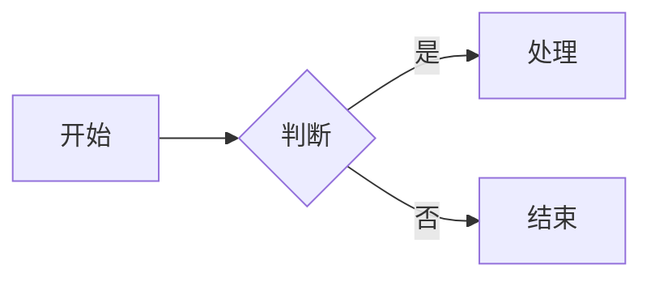

# Mermaid 图表渲染规范（research 参考）

> 属 `skills/research/`（入口与硬纪律在 [../SKILL.md](../SKILL.md)）；本文件是图表跨平台渲染规范，画图时读。

> **目的：** 确保 Mermaid 图表在多平台 markdown 查看器中正常渲染
> **背景：** 部分第三方 markdown 查看器（如 VS Code 插件、GitHub 桌面版、Notion 等）对 Mermaid 语法有严格要求

## F.1 节点标签规则

**禁止在节点标签中使用换行符**

| 错误写法 | 正确写法 | 原因 |
|---------|---------|------|
| `[第一行\n第二行]` | `[第一行 第二行]` | 换行符导致渲染失败 |
| `[文本\nmore text]` | `[文本 more text]` | 用空格替代换行 |

## F.2 子图标题规则

**禁止使用带换行的引号包裹标题**

| 错误写法 | 正确写法 | 原因 |
|---------|---------|------|
| `subgraph "标题\n标题"` | `subgraph A[标题 标题]` | 引号+换行导致解析错误 |
| `subgraph "name\nname"` | `subgraph A[name name]` | 使用括号语法更稳定 |

## F.3 特殊字符处理

**避免使用以下特殊字符**

| 字符类型 | 示例 | 解决方案 |
|---------|------|---------|
| HTML 标签 | ` ` `
` | 删除或改为文本换行，不要在 Mermaid 标签中嵌入 HTML |
| HTML 实体 | `&#34;` `&lt;` `&gt;` | 不要使用 HTML 实体，直接使用原字符或避免特殊字符 |
| 正斜杠 | `/` | 移除或替换为 `-` |
| 箭头符号 | `→` `←` | 使用 ASCII 短横线或文字替代 |
| 双引号 | `"` | 尽量避免，若必须使用请先确认目标平台支持 |
| 特殊符号 | `❌` `✓` `⚠️` | 使用文字替代 `[X]` `[OK]` `警告` |
| 中文标点 | `：` `——` | 用英文标点或空格替代 |

**兼容性建议：**
- 节点标签应尽量保持简单，避免 emoji、HTML 标签、shell 元字符和复杂标点。
- 如果可能，使用英文 ASCII 或常规中文描述，避免混合过多特殊字符。

## F.4 连接线规则

**保持连接线语法简洁**

**兼容性建议：**
- 如果目标平台使用较旧的 Mermaid 版本，`graph LR/TD` 比 `flowchart LR/TD` 更兼容。
- 对包含特殊字符或中文标点的标签，先尝试使用不带引号的普通标签；如果渲染器支持，再考虑使用 `A["节点文本"]`。某些第三方平台或旧版 Mermaid 可能无法正确解析带双引号的标签语法。

- 节点 ID 使用简短标识符
- 连接线标签使用 `|标签|` 格式
- 避免在标签中使用特殊字符

## F.5 常见错误对照表

| 错误场景 | 错误代码 | 修复后代码 |
|---------|---------|-----------|
| 节点内换行 | `[错误\n错误]` | `[错误 错误]` |
| 子图标题换行 | `subgraph "A\nB"` | `subgraph A[A B]` |
| 特殊字符 | `A --> B -- X --> C` | `A --> B --> C` |
| 双引号包裹 | `"节点名"` | `[节点名]` |
| 中文冒号 | `A --> B：处理` | `A --> B: 处理` |

## F.6 验证清单

绘制 Mermaid 图表后检查：

- [ ] 节点标签不包含 `\n` 换行符
- [ ] 子图标题不使用引号包裹
- [ ] 不包含 `/` `"` `❌` 等特殊字符
- [ ] 连接线语法正确
- [ ] 在目标平台测试渲染效果

---
