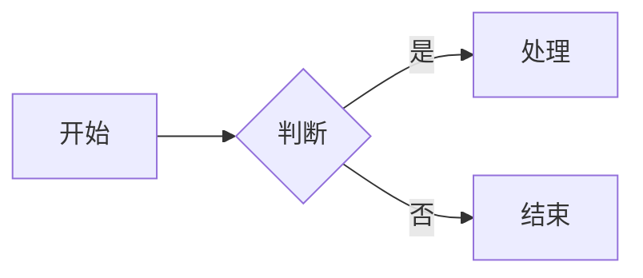

# Technical Research Framework: From Problem to Solution

> **通用技术深度研究框架**
> 适用场景：系统调用、API 设计、架构决策、故障排查等技术深度研究
> 目标：提供从问题识别到工程落地完整的方法论

---

## 核心理念

**"从问题到方案，从原理到工程，从过去到未来"**

一个完整的技术研究应该覆盖：
- 🎯 **问题导向**：从实际问题出发
- 🔬 **原理深入**：理解根本原因  
- 🔧 **工程实践**：提供可操作的解决方案
- 🌐 **生态融合**：结合现代技术栈
- 📈 **持续迭代**：基于反馈不断完善

---

## 模块化文档策略

**目标：** 保持内容高内聚、低耦合，使核心框架清晰、专门主题可复用。

**原则：**
- 将独立性强、可单独成文的部分拆成子文档，例如“故障分析模板”、“研究计划与风险管理”、“Mermaid 渲染规范”等。
- 总文档保留核心框架、流程和概览，并为每个子主题提供链接和简要摘要。
- 子文档开头包含“本主题属于 XX 系列”或“与总框架的关系说明”，确保单篇阅读时有上下文。
- 发布时，总文档可作为系列入口，子文档可作为独立文章或章节引用。

**优点：**
- 易维护：子文档可独立更新，避免总文档臃肿。
- 易传播：读者可按需跳转，博客文章更聚焦。
- 易复用：具体主题可直接引用到其他研究或培训材料。

**缺点：**
- 需要维护链接与版本一致性。
- 单篇复制时可能缺少总框架背景，需补充“本系列说明”。

**建议：**
- 先设计好总文档目录和子文档结构，再拆分。
- 在总文档中保留一份简洁的“系列结构图”或“导航列表”。
- 在子文档末尾加上“返回总文档”或“更多相关主题”链接。

---

## 8 大思考接口

### 接口1：三维度验证

**接口定义：** 理论 + 实践 + 工具 = 完整理解

**操作步骤：**

1. **理论维度**
   - 设计原理是什么？
   - 标准规范是什么？
   - 实现机制是什么？

2. **实践维度**
   - 实际如何使用？
   - 常见问题是什么？
   - 典型场景有哪些？

3. **工具维度**
   - 如何调试？
   - 如何诊断？
   - 如何验证？

**应用示例：system() 研究**
- 理论：三层进程结构、信号处理机制
- 实践：代码示例、故障场景
- 工具：strace、gdb、pstree 等调试工具

---

### 接口2：渐进式深度

**接口定义：** 入门级 → 原理级 → 故障级 → 工程级

**操作步骤：**

1. **入门级**
   - 这个东西是什么？
   - 基本怎么用？
   - 和其他方案对比如何？

2. **原理级**
   - 内部如何实现？
   - 为什么这样设计？
   - 核心机制是什么？

3. **故障级**
   - 会出什么问题？
   - 为什么会出问题？
   - 如何解决问题？

4. **工程级**
   - 生产环境如何使用？
   - 如何保证安全和性能？
   - 现代架构如何适配？

**应用模板：**
```markdown
## 第X章：[主题]（[难度等级]）

### X.1 [主题] 是什么（入门篇）
- 场景介绍
- 基本使用
- 方案对比

### X.2 [主题] 内部机制（原理篇）
- 实现原理
- 代码流程
- 关键机制

### X.3 [主题] 会出什么问题（故障篇）
- 单线程问题
- 多线程问题
- 竞争条件

### X.4 如何正确使用（工程篇）
- 最佳实践
- 安全考虑
- 性能优化
```

---

### 接口3：多视角验证

**接口定义：** 用户视角 + 开发者视角 + 架构师视角 = 全面覆盖

**操作步骤：**

1. **用户视角**
   - 用户体验如何？
   - 响应是否及时？
   - 错误提示是否清晰？

2. **开发者视角**
   - API 是否易用？
   - 文档是否完善？
   - 常见陷阱有哪些？

3. **架构师视角**
   - 设计是否合理？
   - 扩展性如何？
   - 维护成本如何？

**检查清单：**
- [ ] 是否考虑了最终用户体验？
- [ ] 是否考虑了业务/产品目标和价值？
- [ ] 是否提供了开发者友好的接口？
- [ ] 是否符合架构设计原则？
- [ ] 是否考虑了可维护性和可扩展性？

---

### 接口4：问题驱动研究

**接口定义：** 目标与现象 → 原因 → 解决方案 → 预防 = 深度学习

**操作步骤：**

0. **研究目标与成功指标**
   - 这次研究要解决什么核心问题？
   - 预期输出是什么？
   - 成功如何衡量？
   - 有哪些约束条件和假设？

1. **现象识别**
   - 具体表现是什么？
   - 触发条件是什么？
   - 影响范围有多大？

2. **原因分析**
   - 根本原因是什么？
   - 为什么会发生？
   - 相关因素有哪些？

3. **解决方案**
   - 如何临时解决？
   - 如何根本解决？
   - 如何预防再次发生？

4. **预防措施**
   - 如何在设计阶段避免？
   - 如何在代码审查中发现？
   - 如何建立规范和流程？

> 迭代提示：在研究过程中如果发现新的问题或假设，应及时返回“研究目标与成功指标”、“现象识别”或“多视角验证”环节，形成闭环迭代。

**故障分析模板：**
```markdown
## 故障点 [编号]: [名称]（[类型]）

### 现象描述
[具体现象和触发条件]

### 原因分析
[技术原因和根本原因]

### 实际影响
[影响范围和严重程度]

### 解决方案
```c
// 具体代码解决方案
```

### 预防措施
- [ ] 设计阶段如何避免
- [ ] 代码审查如何发现
- [ ] 测试如何覆盖
```

---

### 接口5：技术生态融合

**接口定义：** 单技术 → 技术关联 → 生态融合 = 系统思维

**操作步骤：**

1. **单技术研究**
   - 技术本身如何工作？
   - 核心机制是什么？
   - 优缺点是什么？

2. **技术关联分析**
   - 与哪些技术相关？
   - 会产生什么影响？
   - 如何协同工作？

3. **生态融合考虑**
   - 现代架构如何适配？
   - 云原生环境如何考虑？
   - 未来趋势如何演进？

**生态检查清单：**
- [ ] 是否考虑了容器化环境？
- [ ] 是否考虑了微服务架构？
- [ ] 是否考虑了现代语言特性？
- [ ] 是否考虑了安全性要求？
- [ ] 是否考虑了性能优化？

---

### 接口6：实战导向工程

**接口定义：** 可用性 + 可维护性 + 可扩展性 = 工程价值

**操作步骤：**

1. **可用性保障**
   - 性能如何？
   - 正确性如何？
   - 稳定性如何？

2. **可维护性提升**
   - 代码是否清晰？
   - 调试是否方便？
   - 文档是否完善？

3. **可扩展性设计**
   - 接口是否合理？
   - 设计是否灵活？
   - 未来是否可扩展？

**工程实践检查：**
```markdown
## 工程实践指南

### 性能考虑
- [ ] 性能测试数据
- [ ] 性能优化建议
- [ ] 性能监控方法

### 可维护性
- [ ] 代码审查模式
- [ ] 调试工具和技巧
- [ ] 文档结构设计

### 可扩展性
- [ ] 接口设计原则
- [ ] 扩展点设计
- [ ] 未来兼容性考虑
```

---

### 接口7：安全优先工程

**接口定义：** 识别风险 → 理解攻击 → 防御策略 = 安全工程

**操作步骤：**

1. **风险识别**
   - 有哪些安全风险？
   - 风险等级如何？
   - 影响范围多大？

2. **攻击理解**
   - 攻击者如何利用？
   - 攻击路径是什么？
   - 攻击后果是什么？

3. **防御策略**
   - 如何预防攻击？
   - 如何检测攻击？
   - 如何响应攻击？

**安全分析模板：**
```markdown
## 安全风险分析

### 风险识别
| 风险类型 | 风险等级 | 影响范围 |
|---------|---------|---------|
| [风险1] | [等级] | [范围] |
| [风险2] | [等级] | [范围] |

### 攻击向量
| 攻击方式 | 触发条件 | 后果 |
|---------|---------|------|
| [攻击1] | [条件] | [后果] |
| [攻击2] | [条件] | [后果] |

### 防御策略
1. **预防措施**
   - [ ] [措施1]
   - [ ] [措施2]

2. **检测手段**
   - [ ] [手段1]
   - [ ] [手段2]

3. **响应机制**
   - [ ] [机制1]
   - [ ] [机制2]
```

---

### 接口8：历史演进思维

**接口定义：** 现状 → 原因 → 替代方案 → 未来趋势 = 前瞻思维

**操作步骤：**

1. **现状分析**
   - 当前状况如何？
   - 优缺点是什么？
   - 适用场景是什么？

2. **原因探究**
   - 为什么是这样？
   - 历史原因是什么？
   - 设计考虑是什么？

3. **替代方案**
   - 有什么替代方案？
   - 各自优缺点如何？
   - 如何选择？

4. **未来趋势**
   - 技术如何演进？
   - 需求如何变化？
   - 如何应对？

**演进分析模板：**
```markdown
## 技术演进分析

### 现状分析
**优点：**
- [ ] [优点1]
- [ ] [优点2]

**缺点：**
- [ ] [缺点1]
- [ ] [缺点2]

**适用场景：**
- [ ] [场景1]
- [ ] [场景2]

### 历史原因
**为什么保留：**
- [向后兼容性]
- [简单场景需求]
- [标准要求]

### 替代方案对比
| 方案 | 复杂度 | 安全性 | 性能 | 适用场景 |
|------|--------|--------|------|----------|
| [方案1] | [评级] | [评级] | [评级] | [场景] |
| [方案2] | [评级] | [评级] | [评级] | [场景] |

### 未来趋势
**技术演进：**
- [ ] [趋势1]
- [ ] [趋势2]

**需求变化：**
- [ ] [需求1]
- [ ] [需求2]
```

---

## 完整研究流程

基于以上 8 大接口，完整的技术研究流程如下：

```
1. 问题识别 (接口4)
   ↓
2. 三维度验证 (接口1)
   ↓
3. 渐进式深入 (接口2)
   ↓
4. 多视角分析 (接口3)
   ↓
5. 技术生态融合 (接口5)
   ↓
6. 安全风险分析 (接口7)
   ↓
7. 工程实践落地 (接口6)
   ↓
8. 历史演进思考 (接口8)
```

---

## 研究计划与风险管理

### 研究计划要素
- **目标范围**：明确研究的边界与核心待解问题。
- **时间节点**：定义关键里程碑，如调研、验证、实验和交付阶段。
- **资源与依赖**：明确所需资料、工具、协作对象和外部依赖。
- **输出形式**：确定最终交付的报告、模板、示例代码或结论。

### 风险管理
- **识别假设**：列出关键假设并区分事实与待验证项。
- **评估风险**：判断哪些风险会影响结论、可行性或交付时间。
- **缓解措施**：为高风险项制定备用方案，例如改用替代技术、补充实验数据、寻求专家验证。
- **关键路径**：识别最可能影响交付的节点，并优先保障。

### 建议实践
- 在研究初期形成简短的“研究计划表”，包含目标、成功指标、里程碑和风险清单。
- 在研究过程中定期复盘，及时更新假设、风险和输出预期，保持结果与需求对齐。

---

---

## 应用示例：研究新的系统调用/技术

假设你要研究 `epoll`：

### 第1步：问题识别 (接口4)
- **现象**：select/poll 性能问题
- **原因**：O(n) 复杂度，每次都要遍历所有 fd
- **解决方案**：epoll 提供 O(1) 复杂度

### 第2步：三维度验证 (接口1)
- **理论**：事件驱动模型、内核态/用户态数据结构
- **实践**：代码示例、性能测试
- **工具**：strace、perf、epoll 相关工具

### 第3步：渐进式深入 (接口2)
- **入门**：epoll 基本用法、与 select 对比
- **原理**：红黑树、就绪链表、epoll_wait 机制
- **故障**：EPOLLERR 处理、边缘触发 vs 水平触发
- **工程**：高性能服务器设计、连接池管理

### 第4步：多视角分析 (接口3)
- **用户视角**：响应时间、吞吐量
- **开发者视角**：API 易用性、错误处理
- **架构师视角**：系统设计、扩展性

### 第5步：技术生态融合 (接口5)
- **技术关联**：socket、非阻塞 I/O、事件驱动
- **生态融合**：现代网络库、云原生环境、容器网络

### 第6步：安全风险分析 (接口7)
- **风险识别**：文件描述符泄漏、DoS 攻击
- **攻击理解**：如何利用 epoll 漏洞
- **防御策略**：资源限制、监控告警

### 第7步：工程实践落地 (接口6)
- **性能**：基准测试、优化建议
- **可维护性**：代码模式、调试技巧
- **可扩展性**：框架设计、接口抽象

### 第8步：历史演进思考 (接口8)
- **现状**：epoll 是 Linux 高性能 I/O 的标准
- **原因**：解决了 select/poll 的性能问题
- **替代方案**：io_uring（更现代的方案）
- **未来趋势**：异步 I/O 演进

---

## 输出模板

基于这个框架，研究的最终输出应该包含：

```markdown
# [技术名称] 完全指南

> 目标读者：[读者描述]
> 阅读时间：[预估时间]
> 难度等级：[难度评级]

---

## 目录

- [第1章：[技术] 是什么（入门篇）](#第1章技术是什么入门篇)
- [第2章：[技术] 内部机制（原理篇）](#第2章技术内部机制原理篇)
- [第3章：[技术] 故障分析（故障篇）](#第3章技术故障分析故障篇)
- [第4章：如何正确使用（最佳实践篇）](#第4章如何正确使用最佳实践篇)
- [第5章：故障排查实战（工具篇）](#第5章故障排查实战工具篇)
- [附录](#附录)

---

## 第1章：[技术] 是什么（入门篇）

### 1.1 为什么需要 [技术]

### 1.2 [技术] vs 其他方案

### 1.3 一个简单的例子

---

## 第2章：[技术] 内部机制（原理篇）

### 2.1 核心结构/架构

### 2.2 具体实现流程

### 2.3 关键机制原理

---

## 第3章：[技术] 故障分析（故障篇）

### 3.1 单线程环境故障

### 3.2 多线程环境故障

### 3.3 实际案例

---

## 第4章：如何正确使用（最佳实践篇）

### 4.1 什么时候可以用

### 4.2 什么时候必须避免

### 4.3 安全替代方案

### 4.4 性能优化建议

### 4.5 代码审查模式

---

## 第5章：故障排查实战（工具篇）

### 5.1 诊断流程

### 5.2 排查工具箱

### 5.3 实战案例

---

## 附录

### A. 基础知识补充

### B. 相关系统调用详解

### C. 参考资料和扩展阅读

---

## 总结

[技术] 是一个[优缺点描述]的工具，适合[适用场景]，在[不适用场景]中应该避免。

---

**文档版本：** 1.0
**最后更新：** [日期]
```

---

## 附录F：Mermaid 图表渲染规范

> **目的：** 确保 Mermaid 图表在多平台 markdown 查看器中正常渲染
> **背景：** 部分第三方 markdown 查看器（如 VS Code 插件、GitHub 桌面版、Notion 等）对 Mermaid 语法有严格要求

### F.1 节点标签规则

**禁止在节点标签中使用换行符**

| 错误写法 | 正确写法 | 原因 |
|---------|---------|------|
| `[第一行\n第二行]` | `[第一行 第二行]` | 换行符导致渲染失败 |
| `[文本\nmore text]` | `[文本 more text]` | 用空格替代换行 |

### F.2 子图标题规则

**禁止使用带换行的引号包裹标题**

| 错误写法 | 正确写法 | 原因 |
|---------|---------|------|
| `subgraph "标题\n标题"` | `subgraph A[标题 标题]` | 引号+换行导致解析错误 |
| `subgraph "name\nname"` | `subgraph A[name name]` | 使用括号语法更稳定 |

### F.3 特殊字符处理

**避免使用以下特殊字符**

| 字符类型 | 示例 | 解决方案 |
|---------|------|---------|
| HTML 标签 | `<br/>` `<div>` | 删除或改为文本换行，不要在 Mermaid 标签中嵌入 HTML |
| HTML 实体 | `&#34;` `&lt;` `&gt;` | 不要使用 HTML 实体，直接使用原字符或避免特殊字符 |
| 正斜杠 | `/` | 移除或替换为 `-` |
| 箭头符号 | `→` `←` | 使用 ASCII 短横线或文字替代 |
| 双引号 | `"` | 尽量避免，若必须使用请先确认目标平台支持 |
| 特殊符号 | `❌` `✓` `⚠️` | 使用文字替代 `[X]` `[OK]` `警告` |
| 中文标点 | `：` `——` | 用英文标点或空格替代 |

**兼容性建议：**
- 节点标签应尽量保持简单，避免 emoji、HTML 标签、shell 元字符和复杂标点。
- 如果可能，使用英文 ASCII 或常规中文描述，避免混合过多特殊字符。

### F.4 连接线规则

**保持连接线语法简洁**



**兼容性建议：**
- 如果目标平台使用较旧的 Mermaid 版本，`graph LR/TD` 比 `flowchart LR/TD` 更兼容。
- 对包含特殊字符或中文标点的标签，先尝试使用不带引号的普通标签；如果渲染器支持，再考虑使用 `A["节点文本"]`。某些第三方平台或旧版 Mermaid 可能无法正确解析带双引号的标签语法。

- 节点 ID 使用简短标识符
- 连接线标签使用 `|标签|` 格式
- 避免在标签中使用特殊字符

### F.5 常见错误对照表

| 错误场景 | 错误代码 | 修复后代码 |
|---------|---------|-----------|
| 节点内换行 | `[错误\n错误]` | `[错误 错误]` |
| 子图标题换行 | `subgraph "A\nB"` | `subgraph A[A B]` |
| 特殊字符 | `A --> B -- X --> C` | `A --> B --> C` |
| 双引号包裹 | `"节点名"` | `[节点名]` |
| 中文冒号 | `A --> B：处理` | `A --> B: 处理` |

### F.6 验证清单

绘制 Mermaid 图表后检查：

- [ ] 节点标签不包含 `\n` 换行符
- [ ] 子图标题不使用引号包裹
- [ ] 不包含 `/` `"` `❌` 等特殊字符
- [ ] 连接线语法正确
- [ ] 在目标平台测试渲染效果

---

## 使用建议

1. **研究前准备**
   - 明确研究目标
   - 收集相关资料
   - 制定研究计划

2. **研究中执行**
   - 按照接口顺序执行
   - 记录每个接口的发现
   - 及时调整研究方向

3. **研究后总结**
   - 整理研究成果
   - 编写技术文档
   - 分享实践经验

4. **持续迭代**
   - 收集使用反馈
   - 补充遗漏内容
   - 更新技术发展

---

## 适用场景

这个框架适用于但不限于：

- ✅ 系统调用研究（如 system、fork、epoll）
- ✅ API 设计分析
- ✅ 架构决策研究
- ✅ 故障排查和根因分析
- ✅ 技术选型评估
- ✅ 性能优化研究
- ✅ 安全风险评估
- ✅ 开源项目代码分析

---

**框架版本：** 1.1（2026-10-24 补丁：新增审计钩子）
**创建日期：** 2026-08-11
**基于实践：** system() 函数深度研究

---

## 附录 G：审计钩子（v1.1 补丁，与 report/ 呈现层对接）

> 目的：研究过程中就地产出三张表，报告期（report skill）直接引用，不回炉重查。
> 归属：研究执行层；对接：`skills/report/`（呈现层 L2 追溯 / L3 防幻觉）。

### G.1 数据源登记表（研究期每引一源即登记一行）

| # | 名称 | URL | 抓取日期 | 本地缓存路径 | 类型(规范/文档/代码/工具) |
|---|---|---|---|---|---|
| 1 | 示例 | https://… | 2026-10-24 | sources/… | 代码 |

### G.2 证据清单（每个结论挂证据定位 + 徽章）

| 结论# | 结论 | 证据定位(文件:行/测试名/条目号) | 徽章[TV/HV/LA] | 置信度(GROUNDED/INFERRED/SPECULATIVE) |
|---|---|---|---|---|
| C1 | … | src/…:120 | TV | GROUNDED |

徽章规则：`[TV]` 工具验证 / `[HV]` 人工复核 / `[LA]` 模型推断待复核（默认）。

### G.3 数字登记表（每个进报告的数字先入表）

| # | 数值 | 口径（必须成完整一句） | 出处 | verified |
|---|---|---|---|---|
| D1 | 1567 | diff v3.2.2..v3.4.3 RPC 域新增行数 | git diff --stat | Y |

**红线**：正文数字只能引用本表编号；口径写不成完整一句话的数字禁用（对齐 huashu-report 数字锁机制）。